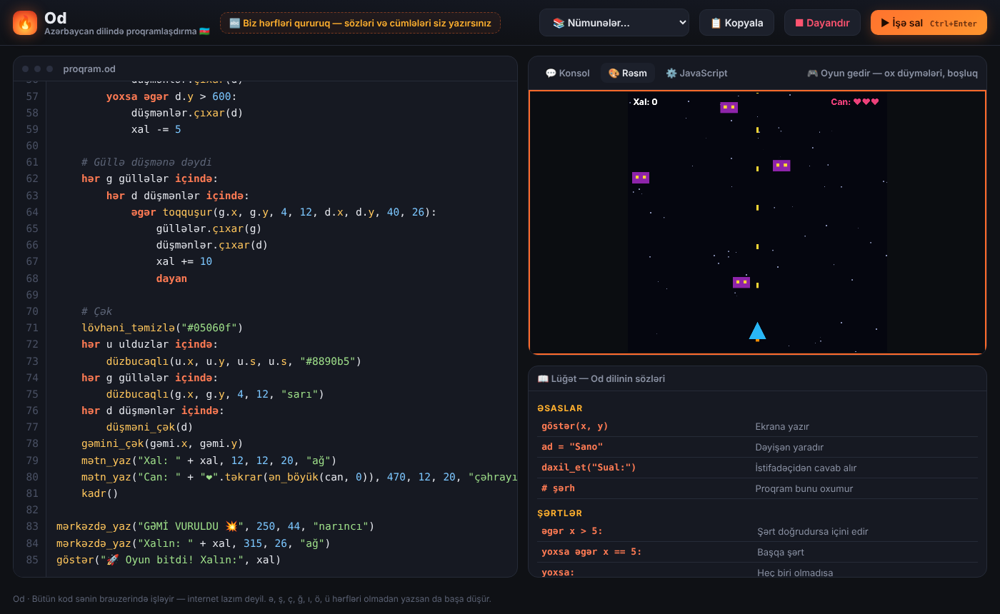
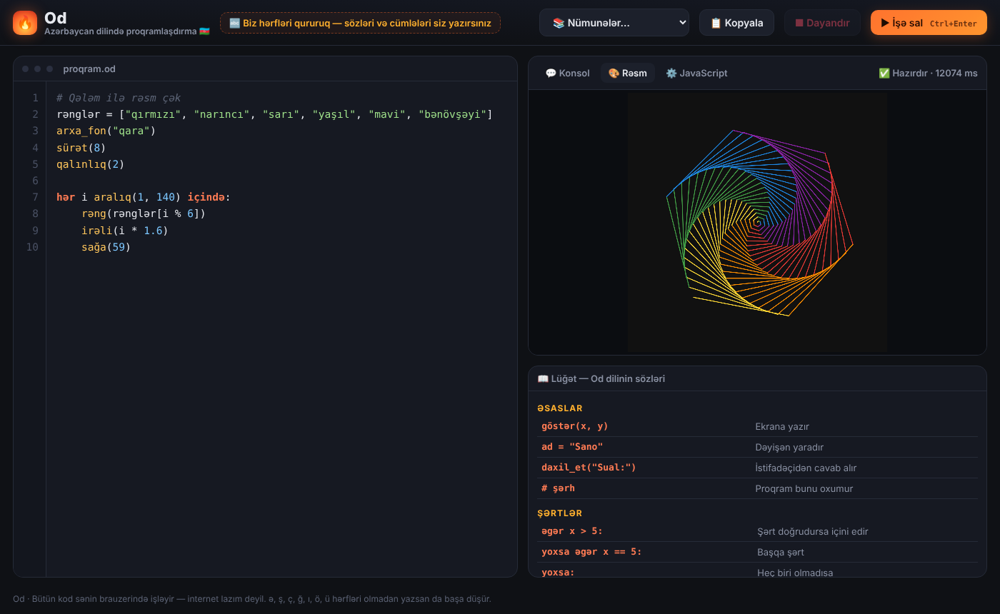
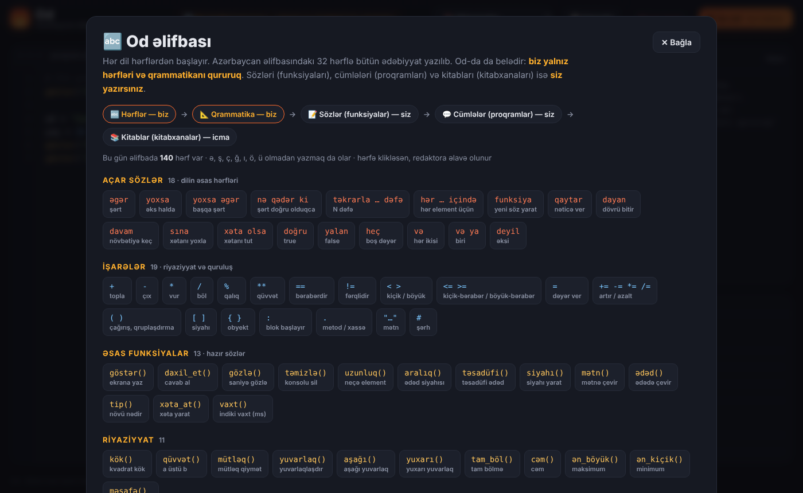

<div align="center">

# 🔥 Od

### Azərbaycan dilində proqramlaşdırma dili

**Biz hərfləri qururuq — sözləri və cümlələri siz yazırsınız.**

[▶ Onlayn sına](https://sano8063.github.io/od/) · [🔤 Əlifba](docs/ELIFBA.md) · [⚙️ Necə işləyir](docs/NECE-ISLEYIR.md) · [🤝 Töhfə ver](CONTRIBUTING.md)



</div>

---

## 🇦🇿 Azərbaycanlı developerlərə çağırış

> Python-u bir nəfər başladı, milyonlarla insan böyütdü.
> Od-u da biz başladıq — indi növbə sizdədir.
>
> Hər azərbaycanlı uşaq proqramlaşdırmanı **ana dilində** öyrənə bilməlidir. Biz dilin hərflərini qurduq. Sözləri, cümlələri və kitabları birlikdə yazaq.
>
> Bir funksiya yaz. Bir oyun əlavə et. Bir xətanı düzəlt. Bir müəllimə göstər.
> **Hər kiçik töhfə Azərbaycanda proqramlaşdırmanın gələcəyinə bir kərpicdir.**
>
> ⭐ Repoya ulduz ver · 🍴 Fork et · 🤝 [Töhfə ver](CONTRIBUTING.md) · 📣 Paylaş

## Od nədir?

**Od** — məktəblilər və yeni başlayanlar üçün Azərbaycan dilində yazılan proqramlaşdırma dilidir. Kod brauzerdə dərhal işləyir: quraşdırma, internet və ya ingilis dili lazım deyil.

```
# Rəqəmi tap oyunu
gizli = təsadüfi(1, 100)

nə qədər ki doğru:
    təxmin = daxil_et("Rəqəmin:")
    əgər təxmin == gizli:
        göstər("Afərin! Tapdın 🎉")
        dayan
    yoxsa əgər təxmin < gizli:
        göstər("Daha böyük ⬆")
    yoxsa:
        göstər("Daha kiçik ⬇")
```

## Niyə Od?

Proqramlaşdırma öyrənən uşaq eyni anda iki çətinliklə üzləşir: **məntiq** və **ingilis dili**. Od ikincisini aradan qaldırır və uşaq yalnız məntiqə fokuslanır. Sonra "⚙️ JavaScript" bölməsində yazdığı kodun ingiliscə qarşılığını görür və əsl dillərə asanlıqla keçir.

## İmkanlar

| | |
|---|---|
| 🇦🇿 **Tam Azərbaycan dilində** | `əgər`, `yoxsa`, `təkrarla`, `funksiya`, `qaytar`… |
| ⌨️ **Hərfsiz yazılış** | `eger` = `əgər`, `sayi` = `sayı` — ə, ş, ç, ğ, ı, ö, ü olmadan da işləyir |
| 💬 **Azərbaycan dilində xətalar** | `Sətir 2: "əgər" sətrinin sonunda ":" unudulub.` |
| 🎮 **Oyunlar** | `kadr()`, `basılıb("sol")`, `toqquşur(...)` — İlan, Kərpic sındır, Kosmik döyüş daxildir |
| 🎨 **Rəsm qələmi** | `irəli(100)`, `sağa(90)`, `rəng("qırmızı")` |
| 🔤 **Yazı stilləri** | `"qalın"`, `"incə"`, `"maili"`, `"xətli"`, `"kod"`, `"klassik"` |
| 🧩 **Obyektlər və xəta tutmaq** | `top = {x: 10, y: 20}`, `sına:` / `xəta olsa:` |
| 🔒 **Tam yerli** | Kod istifadəçinin brauzerində işləyir, heç bir serverə göndərilmir |

<table>
<tr>
<td></td>
<td></td>
</tr>
<tr>
<td align="center">🎨 Rəsm qələmi</td>
<td align="center">🔤 Od əlifbası — dilin bütün 140 hərfi</td>
</tr>
</table>

## Fəlsəfə

Hər dil hərflərdən başlayır. Azərbaycan əlifbasındakı 32 hərflə bütün ədəbiyyat yazılıb.

| Dil | Proqramlaşdırma | Kim yazır? |
|---|---|---|
| 🔤 Hərflər | Açar sözlər, əsas əmrlər | **Od** |
| 📐 Qrammatika | Sintaksis qaydaları | **Od** |
| 📝 Sözlər | Funksiyalar | **Siz** |
| 💬 Cümlələr | Proqramlar | **Siz** |
| 📚 Kitablar | Kitabxanalar | **İcma** |

## Başlamaq

**Ən asan yol:** [onlayn versiyanı aç](https://sano8063.github.io/od/) və ya `index.html` faylını brauzerdə aç.

**Proqramçılar üçün:**

```bash
git clone https://github.com/Sano8063/od.git
cd od
npm test          # testləri işə sal
npm run build     # src/ qovluğundan index.html yığ
```

Heç bir asılılıq (dependency) yoxdur, yalnız Node.js 18+ lazımdır.

## Layihənin quruluşu

```
od/
├── index.html          ← hazır proqram (npm run build ilə yaradılır)
├── src/
│   ├── engine.js       ← Od-un "beyni": çevirici (transpiler) və icra mühiti
│   ├── examples.js     ← nümunə proqramlar və oyunlar
│   └── template.html   ← redaktor, konsol, rəsm lövhəsi
├── tests/od.test.js    ← testlər
├── scripts/build.js    ← yığma skripti
└── docs/               ← sənədlər və şəkillər
```

## Yol xəritəsi

- [x] Əsas dil: şərtlər, dövrlər, funksiyalar, siyahılar
- [x] Azərbaycan dilində xəta mesajları
- [x] Rəsm qələmi və oyun funksiyaları
- [x] Obyektlər, `sına` / `xəta olsa`
- [x] Yazı stilləri və Od əlifbası
- [ ] Siniflər: `sinif Oyunçu:`
- [ ] `gətir`: başqa Od fayllarını və kitabxanaları yükləmək
- [ ] 10 dərslik kurs və avtomatik yoxlanan tapşırıqlar
- [ ] Layihələri saxlamaq və paylaşmaq (hesablar)
- [ ] Müəllim paneli
- [ ] Səs və 3D

## Müəllif

**Hasan Allahverdi (Sano)** — 🇦🇿 Azərbaycan

## Lisenziya

[MIT](LICENSE) — pulsuz istifadə et, dəyişdir, paylaş.
